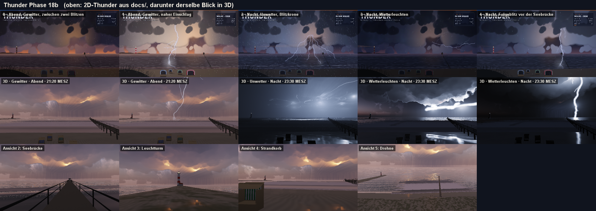

# Thunder – Gewitter über der Ostsee

Java-21-Swing-App (NetBeans/Ant) mit einer animierten Strandszene: ein Sommergewitter über der Ostsee,
frei gestalteter Strand mit Leuchtturm auf der Landzunge, Seebrücke, Strandkörben und Düne.
Stimmung nach `Thunder.jpg` (nachtblau) und `Thunder1.jpg` (orange glühender Wolkenkern).
Stufen, Szene und Farben kommen aus Oracle 21c (Service `PDBORCL`, Schema `DEMO`); jeder Blitz wird
in `TH_STRIKE` protokolliert. Ist die Datenbank nicht erreichbar, läuft die App mit identischen
eingebauten Daten weiter.


## Umbau in 3D (Sylt-Werkbuch Phase 18, F30 A)

Thunder wird eine 3D-Szene auf `Renderer.jar` (wie Sylt, Brocken und Lighthouse). Strand, Stufen, Abend und Nacht und die
Bedienung bleiben; das Schema bleibt DEMO.

**Stand 18a, das Gerüst:**

- **Gelände:** der Ostseestrand gerechnet (`scene.Gelaende`). Düne mit dem Standpunkt des Hauptblicks, Strand bis zur
  Wasserlinie 41 m voraus, Vorstrand mit Riff, eine Landzunge mit dem Leuchtturm links, Hinterland.
- **See:** `ocean` mit dem Gelände als Grund. Davor die Brecher und der Auflauf aus `surf` mit `Surf.ostsee()`
  (`scene.Brandung`).
- **Himmel und Wolken:** `sky` über 54,0° N am 15. Juli und `cloud` (Cumulonimbus).
- **Bauten:** Leuchtturm mit roten Bändern, Seebrücke mit Häuschen und Laterne, vier Strandkörbe mit Streifen wie in
  `TH_SCENE_OBJECT` (`scene.Bauwerke`).
- **Stufe und Stimmung:** Die Stufe stellt Wind, See und Wolken. Abend und Nacht stellen die Uhr auf 21:20 bzw.
  23:30 Uhr, weich über 1,5 s.
- **Ansichten:** Tasten 1 bis 5 (Hauptblick, Seebrücke, Leuchtturm, Strandkorb, Drohne). Die Maus dreht, das Rad zoomt,
  H schaltet das HUD, F12 macht ein Foto.
- **Statusbild:** `ant statusbild` (`tools.Statusbild`) legt die fünf Bilder aus `docs/` über denselben Blick in 3D.

**Stand 18b, das Gewitter:**

- **Regie:** Der `StormDirector` aus dem 2D-Thunder entscheidet weiter nach `TH_STORM_LEVEL`, wann ein Blitz kommt,
  welcher Art und wie weit weg. `scene.Gewitter` setzt das in den Raum: Die Stelle im Bild wird eine Peilung im
  Blickfeld des Hauptblicks.
- **Blitze:** `lightning` baut und zeichnet sie. Erdblitze schlagen in See und Strand oder in den Leuchtturm. In der
  Wolke gibt es Wolken- und Spinnenblitze, weit draußen Wetterleuchten. Die Krone besteht aus 4 bis 7 Spinnenblitzen
  rings um den Glutkern. Gelände, Bauten, See, Brecher, Regen und Wolken bekommen ihr Licht, und die Belichtung gibt im
  Blitz nach. „Sanfte Blitze“ nimmt zwei Drittel des Lichts und das Flackern.
- **Glutkern:** ein schwaches, atmendes Licht in einer Zelle der Gewitterwolke, Farbe EMBER aus `TH_PALETTE`, Stärke
  EMBER der Stufe. Er leuchtet über die Lichtpunkte der Wolke, `cloud` bleibt unverändert.
- **Regen:** `rain` mit Vorhängen, Streifen, Krönchen und Ringen auf der See: Wetterleuchten 1,4 mm/h, Gewitter 10,
  Unwetter 30. Der Sand wird nass.
- **Laternen:** Leuchtturm und Seebrücke brennen in der Farbe LAMP.
- **Klang:** `soundscape` statt des alten Synthesizers (`gl.Klang`): Donner aus dem Kanal jedes Blitzes mit Laufzeit,
  Regen, Wind, Strandhafer, die ferne Brandung entlang der Wasserlinie, einzelne Brecher und Schwälle vor dem
  Hauptblick, Wellen an den Pfählen der Seebrücke.
- Die alten Pakete `render` und `audio` und der `ScreenshotHarness` sind entfernt.

**Stand 18c, Bedienung, Datenbank, Prüfung:**

- **Fenster:** startet maximiert, „Wiederherstellen“ in der Titelleiste stellt die Größe von vorher her.
- **Klick in die Szene:** ein Blitz über die Regie (im Protokoll als KLICK). Im Himmel gilt wie im 2D-Thunder: je
  höher der Klick, desto näher (0,4 bis 9,4 km). Auf See und Strand schlägt er genau dort ein.
- **Tasten:** B Erdblitz in Blickrichtung, K Blitzkrone, T Einschlag in den Leuchtturm, G nächste Qualitätsstufe,
  1 bis 5 Ansichten, H HUD, F12 Foto.
- **Blitzkarte** oben rechts wie im 2D-Thunder: der letzte Blitz mit Art, Abstand, Richtung und kA, der Countdown zum
  Donner, Blitze je Minute. Kommt der Donner eines Blitzes unter 1,5 km an, **bebt das Bild**.
- **Datenbank:** `sql/04_th_3d.sql` (wiederholbar, auch auf einer bestehenden Installation):
  - `TH_SCENE_OBJECT` bekommt die Lage in Metern (`X_M`, `Z_M`, `ROT_DEG`).
  - Neue Tabelle `TH_VIEW` mit den fünf Ansichten.
  - `TH_STRIKE` bekommt den Ort jedes Blitzes in Metern (`X_M`, `Z_M`) und seine Art in `lightning` (`BOLT_KIND`).
  - Neue Sicht `TH_STRIKE_ORT_V` zeigt die Blitze mit Peilung und Abstand.

  Die App nimmt die Strandkörbe und die Ansichten aus der Datenbank. Leuchtturm und Seebrücke hängen am Gelände,
  ihre Lage in der Datenbank dient dem Auswerten. Ohne `04` oder ohne Datenbank gelten die eingebauten Werte.
- **Blitzprotokoll:** jeder Blitz nach `TH_STRIKE`, gesammelt alle 3 s in einem eigenen Faden.
- **Prüfung:** `ant pruefung` (`tools.Pruefung`) läuft ohne Fenster: Daten = SQL = Code, Regie im Raum je Stufe,
  Glutkern, Regen, Klick und Tasten, Beben, Donner, Bauten, Datenbank. Die letzte Zeile lautet „alles in Ordnung“.
- **Dauerlauf:** `ant dauerlauf` (`tools.Dauerlauf`, 30 Minuten). Das Protokoll steht in
  `docs/status/Dauerlauf_Phase18c.txt`.



## Rückfluss aus Timmendorf (Phase 18, F29 A)

Aus dem „Projekt des Segels“ kommen Segelboote und Flaggen an den Ostseestrand (`scene.Segler`, Haken „Segler“ in der Bedienleiste):

- **Boote** aus `com.dan.sail`: zwei Fahrtenyachten (34 ft) und ein Gaffelschoner laufen 350 bis 1 100 m vor dem Strand hin und her. Der Südwestwind steht quer zur Küste, beide Kurse sind halber Wind; am Ende des Reviers drehen sie. Fahrt, Krängung und Abdrift rechnet `sail`: rund 7 kn beim Wetterleuchten, 8 bis 9 kn im Unwetter mit gut 20° Krängung. Im Blitz bekommen sie sein Licht.
- **Flaggen** aus `com.dan.cloth`: am Kopf der Seebrücke die Landesflagge, am Strand vor den Körben die rote Flagge „Baden verboten“ (bei Gewitter gesetzt), beide an 6-m-Stangen, nass im Regen.
- `ant renderer` holt das neue `Renderer.jar` (mit `sail` und `cloth`), `check-packages` prüft es.
- `ant vergleichsbild -Dstand=… [-Drueckfluss=aus]` rechnet das Vergleichsblatt nach `docs/rueckfluss/`; mit `aus` bleibt die Szene, wie sie war.
- Die Prüfung hat dafür den Teil „Segler und Flaggen“ (je Stufe 15 Minuten: Revier, Fahrt, Krängung, Flaggen nach Nordost).

## Start

1. **Datenbank** (einmalig, als `DEMO`): in SQL Developer `sql/00_th_install.sql` öffnen und mit **F5** als Skript ausführen,
   oder `sqlplus DEMO@//localhost:1521/PDBORCL @sql/00_th_install.sql`.
   Am Ende zeigt `03_th_check.sql` die erwarteten Zeilenzahlen (3 / 1 / 7 / 34 / 5 / 7).
   Auf einer bestehenden Installation (das Blitzprotokoll bleibt) reicht `sql/04_th_3d.sql`; `00` löscht alles.
2. **App**: In NetBeans *Run Project* (Hauptklasse `com.dan.thunder.app.ThunderApp`).
   Programmargumente: `--offline` (ohne Datenbank), `--nacht` (mit Nachtstimmung starten statt Abend).

Die Verbindung steht in `src/com/dan/thunder/thunder.properties`. Wer sie ändern will, ohne neu zu bauen,
legt eine `thunder.properties` ins Arbeitsverzeichnis; diese Datei hat Vorrang. Mit `db.logStrikes=false`
wird nichts nach `TH_STRIKE` geschrieben.

## Bedienung

| Aktion | Wirkung |
|---|---|
| Wetterleuchten · Gewitter · Unwetter | Stufe aus `TH_STORM_LEVEL`: Blitzrate, Blitzarten, Entfernung, Regen, Wind, Glutkern |
| Abend · Nacht | Farbstimmung aus `TH_PALETTE`, weich überblendet (1,5 s) |
| Klick in den Himmel | Blitz an dieser Stelle; je höher der Klick, desto näher der Einschlag |
| Regen | Regen und Spritzer ein/aus (auch im Ton) |
| Ton | erzeugter Klang, ohne Audiodateien: Donner mit echter Laufzeit (≈ 2,9 s/km), Regen, Brandung |
| Sanfte Blitze | eine gedämpfte Entladung statt Flackern, schwaches Blitzlicht – für empfindliche Augen |
| Theme-Auswahl | FTheme-Preset für die Bedienelemente; die Szene behält ihren eigenen Look |
| Klick auf See oder Strand | Einschlag genau dort (seit 3D) |
| 1 bis 5 · Pos1 | Ansichten aus `TH_VIEW`: Hauptblick, Seebrücke, Leuchtturm, Strandkorb, Drohne |
| Maus ziehen · Rad · W A S D | drehen, zoomen, gehen (F: Kreisen oder Frei, R: Kreisen läuft) |
| B · K · T | Erdblitz in Blickrichtung · Blitzkrone · Einschlag in den Leuchtturm |
| G | nächste Qualitätsstufe (Niedrig, Mittel, Hoch, Ultra) |
| H · F12 | HUD kurz, voll, aus · Foto nach `docs/status` |

Die Karte oben rechts zeigt den letzten Blitz: Art, Entfernung, Scheitelstrom (kA), Countdown bis zum Donner
und Blitze pro Minute.

**Effekte:** Blitze aus Mittelpunktverschiebung mit Seitenästen; echter Ablauf aus Leitblitz (Äste wachsen sichtbar),
Hauptentladung, 2–4 Folgeblitzen und violettem Nachglimmen. Drei Arten: Wolke–Erde, Spinnenblitz in der Wolke,
Blitzkrone aus dem Glutkern. Wolken in drei Tiefen mit Parallaxe, von unten im Blitzlicht erhellt;
atmender Glutkern; Blitz und Lichtstraße spiegeln sich in der Ostsee; Strandkörbe werfen Schlagschatten und zeigen
im Blitzlicht ihre Streifen; der Leuchtturm zeigt seine roten Bänder, sein Lichtkegel kreist durch den Regen;
Seebrücke mit flackernder Laterne; Brandung; Strandhafer im Wind; Regen mit Spritzern; das Bild bebt, wenn der
Donner eines sehr nahen Blitzes ankommt.

## Aufbau

```
com.dan.thunder
├─ app      ThunderApp (FFrame-Hülle, lädt im Hintergrund, verdrahtet Protokoll und Ton), ControlBar (F-Komponenten)
├─ model    StormLevel, Scene, SceneObject, Palette/PaletteRole, Mood, ThunderData
├─ storm    StormDirector (Regie, Donner-Laufzeit), Strike, Envelope (Lichtkurve), BoltGenerator (Seed-basiert),
│           Stage (Bildgeometrie), StormListener
├─ data     ThunderRepository → OracleThunderRepository (JDBC) | BuiltinThunderRepository
│           StrikeLogger (schreibt gesammelt nach TH_STRIKE, eigener Thread), DbConfig (thunder.properties)
├─ audio    ThunderSynth (Rauschen + Biquad-Filter → javax.sound, eigener Thread)
└─ render   StormCanvas (15-ms-Timer, Ebenen von hinten nach vorn), CloudDeck (Wolken in halber Auflösung),
            LightMixer (Blitzlicht auf Wolken), Upscale, BoltPainter, ScenePainter, RainField, Hud, Sprites
```

**Datenbank (Präfix `TH_`, Schlüssel über Sequence + Trigger)**

| Tabelle | Inhalt |
|---|---|
| `TH_STORM_LEVEL` | 3 Stufen: Rate, Anteile Wolke/Krone (Rest Wolke–Erde), Entfernungsbereich, Regentropfen, Wind, Glut |
| `TH_SCENE` | Szene `OSTSEE`: Horizont, Uferlinie, Lage des Glutkerns (Anteile der Bildgröße) |
| `TH_SCENE_OBJECT` | 7 Objekte: Leuchtturm, Seebrücke, Düne, 4 Strandkörbe mit Streifenfarbe |
| `TH_PALETTE` | 17 Farbrollen je Stimmung `ABEND` / `NACHT` |
| `TH_STRIKE` | Blitzprotokoll: Zeit, Stufe, Stimmung, Art, Auslöser (AUTO/KLICK), Entfernung, kA, Position, Seed |
| `TH_STRIKE_DAY_V` | Auswertung je Tag und Stufe |

Mit dem gespeicherten `SEED` erzeugt `StormDirector.spawn(…)` genau dieselbe Blitzform wieder.

## Tests

- `test/com/dan/thunder/ThunderSmokeTest` – ohne Oberfläche und Datenbank: eingebaute Daten = `sql/02_th_data.sql`,
  Seed ergibt denselben Blitz, Entfernungen je Stufe, Donnerlaufzeit, Lichtkurve, Tonpegel.
- `test/com/dan/thunder/ScreenshotHarness` – startet die App und speichert die Bilder in `docs/`.

## Bilder

| | |
|---|---|
|  Abend, zwischen zwei Blitzen |  Unwetter, Blitzkrone aus dem Glutkern |
|  Wetterleuchten in der Wolke |  Naher Einschlag vor der Seebrücke |
