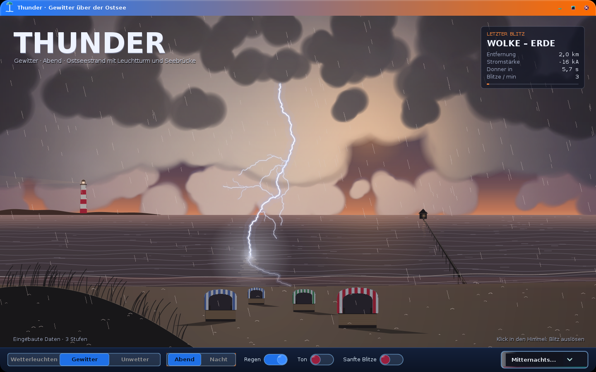
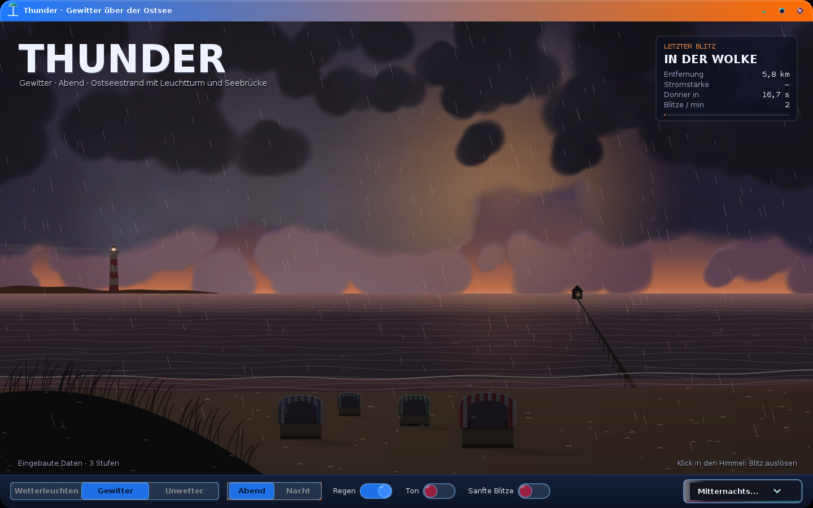
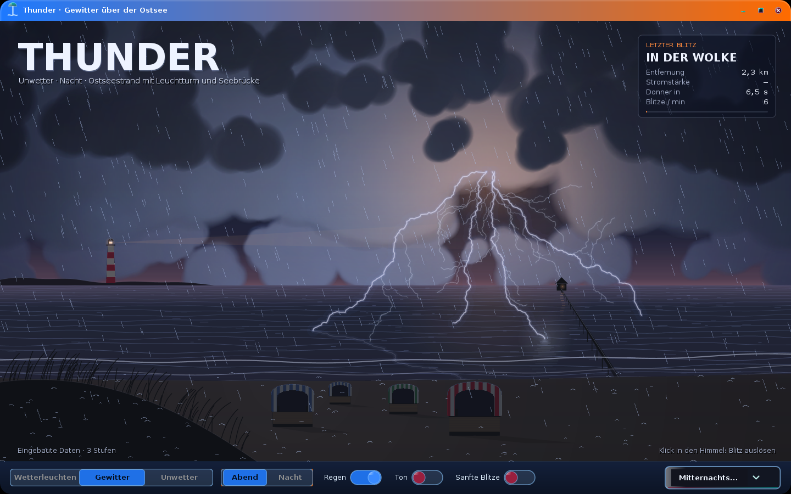
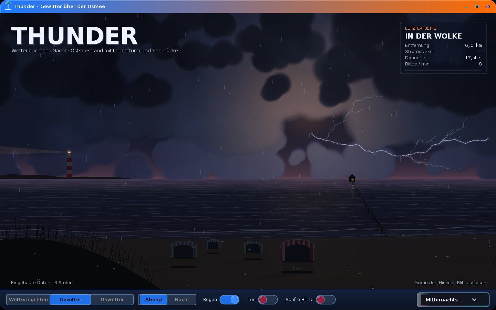
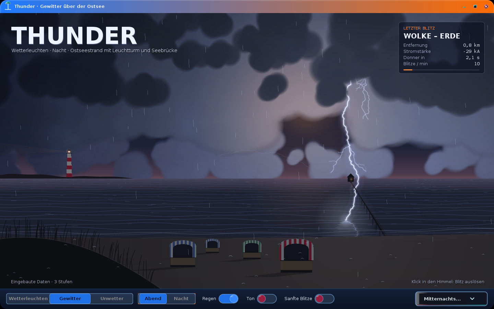

# Thunder – Gewitter über der Ostsee

Java-21-Swing-App (NetBeans/Ant) mit einer animierten Strandszene: ein Sommergewitter über der Ostsee,
frei gestalteter Strand mit Leuchtturm auf der Landzunge, Seebrücke, Strandkörben und Düne.
Stimmung nach `Thunder.jpg` (nachtblau) und `Thunder1.jpg` (orange glühender Wolkenkern).
Stufen, Szene und Farben kommen aus Oracle 21c (Service `PDBORCL`, Schema `DEMO`); jeder Blitz wird
in `TH_STRIKE` protokolliert. Ist die Datenbank nicht erreichbar, läuft die App mit identischen
eingebauten Daten weiter.



## Start

1. **Datenbank** (einmalig, als `DEMO`): in SQL Developer `sql/00_th_install.sql` öffnen und mit **F5** als Skript ausführen,
   oder `sqlplus DEMO@//localhost:1521/PDBORCL @sql/00_th_install.sql`.
   Am Ende zeigt `03_th_check.sql` die erwarteten Zeilenzahlen (3 / 1 / 7 / 34).
2. **App**: In NetBeans *Run Project* (Hauptklasse `com.dan.thunder.app.ThunderApp`).
   Programmargumente: `--offline` (ohne Datenbank), `--nacht` (mit Nachtstimmung starten statt Abend).

Die Verbindung steht in `src/com/dan/thunder/thunder.properties`. Wer sie ändern will, ohne neu zu bauen,
legt eine `thunder.properties` ins Arbeitsverzeichnis; diese Datei hat Vorrang. Mit `db.logStrikes=false`
wird nichts nach `TH_STRIKE` geschrieben.

## Bedienung

| Aktion | Wirkung |
|---|---|
| Wetterleuchten · Gewitter · Unwetter | Stufe aus `TH_STORM_LEVEL`: Blitzrate, Blitzarten, Entfernung, Regen, Wind, Glutkern |
| Abend · Nacht | Farbstimmung aus `TH_PALETTE`, weich überblendet (1,5 s) |
| Klick in den Himmel | Blitz an dieser Stelle; je höher der Klick, desto näher der Einschlag |
| Regen | Regen und Spritzer ein/aus (auch im Ton) |
| Ton | erzeugter Klang, ohne Audiodateien: Donner mit echter Laufzeit (≈ 2,9 s/km), Regen, Brandung |
| Sanfte Blitze | eine gedämpfte Entladung statt Flackern, schwaches Blitzlicht – für empfindliche Augen |
| Theme-Auswahl | FTheme-Preset für die Bedienelemente; die Szene behält ihren eigenen Look |

Die Karte oben rechts zeigt den letzten Blitz: Art, Entfernung, Scheitelstrom (kA), Countdown bis zum Donner
und Blitze pro Minute.

**Effekte:** Blitze aus Mittelpunktverschiebung mit Seitenästen; echter Ablauf aus Leitblitz (Äste wachsen sichtbar),
Hauptentladung, 2–4 Folgeblitzen und violettem Nachglimmen. Drei Arten: Wolke–Erde, Spinnenblitz in der Wolke,
Blitzkrone aus dem Glutkern. Wolken in drei Tiefen mit Parallaxe, von unten im Blitzlicht erhellt;
atmender Glutkern; Blitz und Lichtstraße spiegeln sich in der Ostsee; Strandkörbe werfen Schlagschatten und zeigen
im Blitzlicht ihre Streifen; der Leuchtturm zeigt seine roten Bänder, sein Lichtkegel kreist durch den Regen;
Seebrücke mit flackernder Laterne; Brandung; Strandhafer im Wind; Regen mit Spritzern; das Bild bebt, wenn der
Donner eines sehr nahen Blitzes ankommt.

## Aufbau

```
com.dan.thunder
├─ app      ThunderApp (FFrame-Hülle, lädt im Hintergrund, verdrahtet Protokoll und Ton), ControlBar (F-Komponenten)
├─ model    StormLevel, Scene, SceneObject, Palette/PaletteRole, Mood, ThunderData
├─ storm    StormDirector (Regie, Donner-Laufzeit), Strike, Envelope (Lichtkurve), BoltGenerator (Seed-basiert),
│           Stage (Bildgeometrie), StormListener
├─ data     ThunderRepository → OracleThunderRepository (JDBC) | BuiltinThunderRepository
│           StrikeLogger (schreibt gesammelt nach TH_STRIKE, eigener Thread), DbConfig (thunder.properties)
├─ audio    ThunderSynth (Rauschen + Biquad-Filter → javax.sound, eigener Thread)
└─ render   StormCanvas (15-ms-Timer, Ebenen von hinten nach vorn), CloudDeck (Wolken in halber Auflösung),
            LightMixer (Blitzlicht auf Wolken), Upscale, BoltPainter, ScenePainter, RainField, Hud, Sprites
```

**Datenbank (Präfix `TH_`, Schlüssel über Sequence + Trigger)**

| Tabelle | Inhalt |
|---|---|
| `TH_STORM_LEVEL` | 3 Stufen: Rate, Anteile Wolke/Krone (Rest Wolke–Erde), Entfernungsbereich, Regentropfen, Wind, Glut |
| `TH_SCENE` | Szene `OSTSEE`: Horizont, Uferlinie, Lage des Glutkerns (Anteile der Bildgröße) |
| `TH_SCENE_OBJECT` | 7 Objekte: Leuchtturm, Seebrücke, Düne, 4 Strandkörbe mit Streifenfarbe |
| `TH_PALETTE` | 17 Farbrollen je Stimmung `ABEND` / `NACHT` |
| `TH_STRIKE` | Blitzprotokoll: Zeit, Stufe, Stimmung, Art, Auslöser (AUTO/KLICK), Entfernung, kA, Position, Seed |
| `TH_STRIKE_DAY_V` | Auswertung je Tag und Stufe |

Mit dem gespeicherten `SEED` erzeugt `StormDirector.spawn(…)` genau dieselbe Blitzform wieder.

## Tests

- `test/com/dan/thunder/ThunderSmokeTest` – ohne Oberfläche und Datenbank: eingebaute Daten = `sql/02_th_data.sql`,
  Seed ergibt denselben Blitz, Entfernungen je Stufe, Donnerlaufzeit, Lichtkurve, Tonpegel.
- `test/com/dan/thunder/ScreenshotHarness` – startet die App und speichert die Bilder in `docs/`.

## Bilder

| | |
|---|---|
|  Abend, zwischen zwei Blitzen |  Unwetter, Blitzkrone aus dem Glutkern |
|  Wetterleuchten in der Wolke |  Naher Einschlag vor der Seebrücke |
